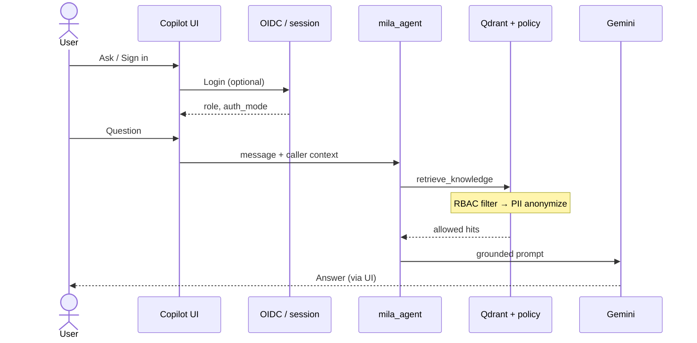
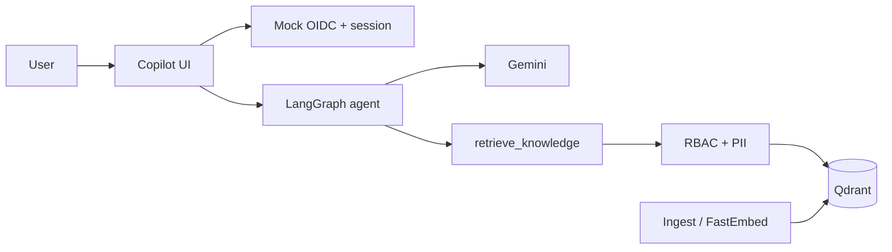
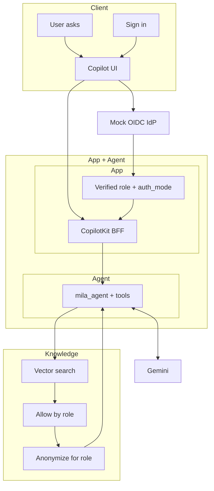

# App architecture

Permission-aware RAG chat for aliM AI Institute: Next.js + CopilotKit UI, LangGraph agent, Qdrant knowledge base, Gemini for generation.

## Components

| Layer | Path | Responsibility |
| --- | --- | --- |
| Chat UI | `copilot/` | Next.js App Router, CopilotKit sidebar, auth UX, thread persistence |
| Auth routes | `copilot/src/app/api/auth/*` | OIDC login/callback/logout/me; sealed session cookie |
| Copilot runtime | `copilot/src/app/api/copilotkit` | Bridges browser → LangGraph Agent Server |
| Agent | `agent/` | ReAct graph (`mila_agent`), tools, RBAC-filtered retrieve |
| Ingest | `ingest/` | Chunk corpus → FastEmbed → Qdrant payloads |
| IdP (local) | `mock-oauth2/` | Mock OIDC for four personas |
| Vector DB | Qdrant | Chunks + ACL metadata (`sensitivity`, `intended_audience`, …) |

## Request path

What happens on one ask (optional sign-in first).



## Layers

Who talks to whom.



## Trust boundaries

Client (Copilot UI) beside App + Agent; mock IdP sits outside and feeds the verified role.



## Chat request path

1. User sends a message in the Copilot UI.
2. Browser → `POST /api/copilotkit` with agent `mila_agent` and `properties` (`auth_mode`, `role`, `mila_user_id`, …).
3. CopilotKit Runtime → LangGraph Agent Server (`LANGGRAPH_URL`).
4. CopilotKit maps matching property keys into LangGraph `AgentContext`.
5. Model may call `retrieve_knowledge` → Qdrant filter from `access_policy` → grounded reply.

Unauthenticated retrieve returns `status=auth_required` so the agent can call `prompt_sign_in` instead of searching.

## Frontend shell

`Providers` (`copilot/src/app/providers.tsx`) owns the composition: **UserBar**, **CopilotKit** (`threadId` + `properties`), **ThreadMessageCache** / **FlushThreadOnLogin** (OIDC-safe transcript), **ChatAuthDemo** (`prompt_sign_in` / `prompt_switch_user`), **CopilotSidebar**.

## Thread restore across OIDC

OIDC is a full-page redirect. To keep one conversation:

- Stable `threadId` in `localStorage` (+ `?thread=` on `returnTo`).
- Message cache keyed by thread; re-applied if the live transcript is shorter after reconnect.
- Do not remount CopilotKit on auth alone (key is `threadId` only).
- Sign-out / user switch clears thread + message caches via `destroyClientThreadState`.

## Data plane (ingest → retrieve)

```text
documents.jsonl  →  chunk + PII detect + FastEmbed  →  Qdrant points
                                         payload: text, ACL fields, pii_spans, …
retrieve_knowledge  →  vector search + role filter  →  anonymize by role  →  LLM
```

Embeddings: in-process FastEmbed (`BAAI/bge-small-en-v1.5`). Gemini is used only for chat generation.

## Related

- [OAuth + RBAC](./oauth-rbac.md)
- [PII handling](./pii.md)
