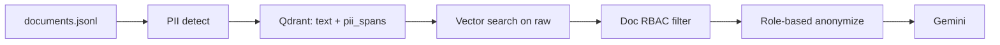

# PII handling

Design for Phase 3. Document RBAC ([oauth-rbac](./oauth-rbac.md)) decides *which chunks* are visible; this policy decides *what PII inside those chunks* a role may see.

Ground-truth labels in `instructions/pii_labels.jsonl` are for **offline evaluation only** — do not load them at runtime.

## Agreed pipeline

1. **Detect at ingest** (once) — run a PII analyzer over chunk text.
2. **Store next to the chunk** — keep raw `text` plus spans (and category tags) on the Qdrant payload.
3. **RAG may load raw** from Qdrant (search/embeddings stay on real tokens).
4. **Anonymize before the LLM** — apply `(role, category) → allow | mask | redact | refuse` using stored spans (or pick a precomputed view). Never send unprotected raw PII to the model for roles that should not see it.



### Why not mask at ingest only?

Masking the indexed string hurts recall (`Priya` → `****` no longer matches name queries). Detect once, index raw, enforce late.

### Why not detect on every retrieve?

Naive “mask before LLM” re-runs NER on the hot path. Spans (or precomputed views) move detection to ingest; retrieve only applies policy.

## Payload shape (planned)

Extend today’s ingest payload (`pii_categories` already reserved) roughly like:

```json
{
  "text": "Priya contacted support about invoice 8821.",
  "pii_categories": ["name", "financial"],
  "pii_spans": [
    { "start": 0, "end": 5, "category": "name" },
    { "start": 38, "end": 42, "category": "financial" }
  ]
}
```

Offsets must use one stable encoding (Unicode code points **or** UTF-8 bytes). Re-chunk ⇒ recompute spans.

Assignment categories (`instructions/data_dictionary.md`):

| Category | Covers |
| --- | --- |
| `name` | Full names |
| `contact` | Email, phone, residential address |
| `identifier` | Gov IDs, dates of birth |
| `financial` | Comp, payroll, banking |
| `sensitive_narrative` | Medical notes, performance evals, etc. |

## Role × category policy (sketch)

Exact matrix is product judgment; document it next to `ROLE_ACCESS`. Example direction:

| Category | public | employee | engineering | hr / security |
| --- | --- | --- | --- | --- |
| name | mask | mask or allow* | allow* | allow |
| contact | mask | mask | mask | allow (need-to-know) |
| identifier | redact | redact | redact | allow / mask |
| financial | redact | redact | redact | allow (hr) / mask |
| sensitive_narrative | refuse chunk or heavy redact | redact | redact | allow if doc RBAC already passed |

\*Names in company-wide docs may be allow for staff; tighten if the corpus mixes personal HR narrative into broader docs.

Policy actions:

- **allow** — leave span text
- **mask** — replace with `****` or `<NAME>`
- **redact** — remove span (possibly collapse whitespace)
- **refuse** — drop hit or refuse to answer when the only matches are over-sensitive

## Precomputed views (optional)

If splicing on every request is undesirable and policy is stable, bake strings at ingest:

```json
{
  "text": "<raw>",
  "text_views": {
    "public": "…",
    "employee": "…",
    "hr": "…"
  }
}
```

Retrieve selects `text_views[tier]` by role. Tradeoff: more storage; policy changes need re-bake. Spans alone are enough for the prototype.

## Tooling

| Need | Choice |
| --- | --- |
| Detect | [Presidio Analyzer](https://github.com/data-privacy-stack/presidio) (`presidio-analyzer` + spaCy) — local, MIT, returns `start` / `end` / `entity_type` |
| Mask | Presidio Anonymizer (`replace` / `mask` / `redact`) |
| Unmask | Usually **not needed** if raw is stored and privileged roles get allow; use `encrypt`/`decrypt` only for reversible LLM round-trips |

Map Presidio entities → assignment categories (e.g. `PERSON` → `name`, `EMAIL_ADDRESS`/`PHONE_NUMBER` → `contact`). Add custom recognizers for lab-specific IDs. `sensitive_narrative` may need heuristics or LLM assist beyond NER.

Lighter alternatives: scrubadub, DataFog. Prefer avoiding paid cloud DLP APIs for the take-home unless demonstrating an enterprise detector.

## Enforcement points

| Stage | Action |
| --- | --- |
| Ingest | Detect + store spans / optional views |
| Retrieve | Doc RBAC first; then anonymize hit `text` for the caller role |
| Generate | Model sees only role-safe text |
| Client / logs | Same policy if tool results are streamed or logged |

Treat retrieved bodies as **untrusted** (adversarial instructions). PII masking does not replace that rule.

## Offline eval

Compare detector output to `pii_labels.jsonl` document-level categories for precision/recall of *presence*, and spot-check spans against bodies. Do not wire that file into ingest or the agent.

## Status

- **Documented** — this design.
- **Not implemented yet** — ingest still writes empty `pii_categories`; retrieve returns raw `text` after RBAC.

## Related

- [Architecture](./architecture.md)
- [OAuth + RBAC](./oauth-rbac.md)
