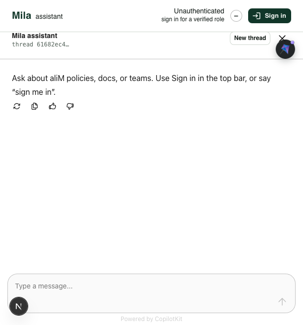
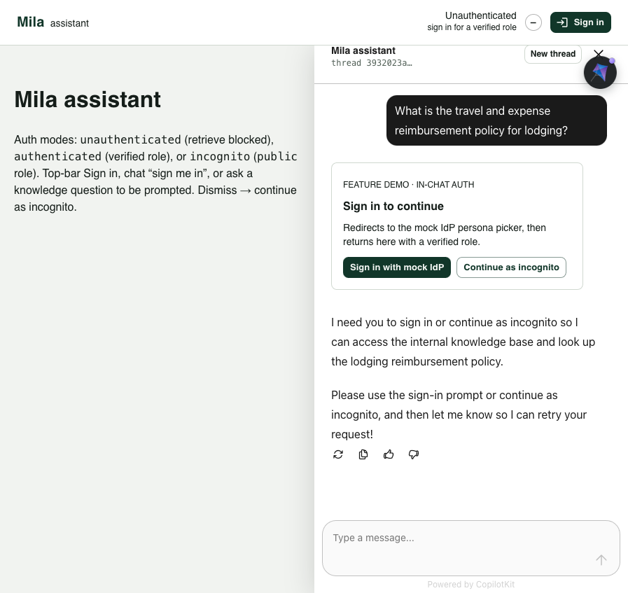
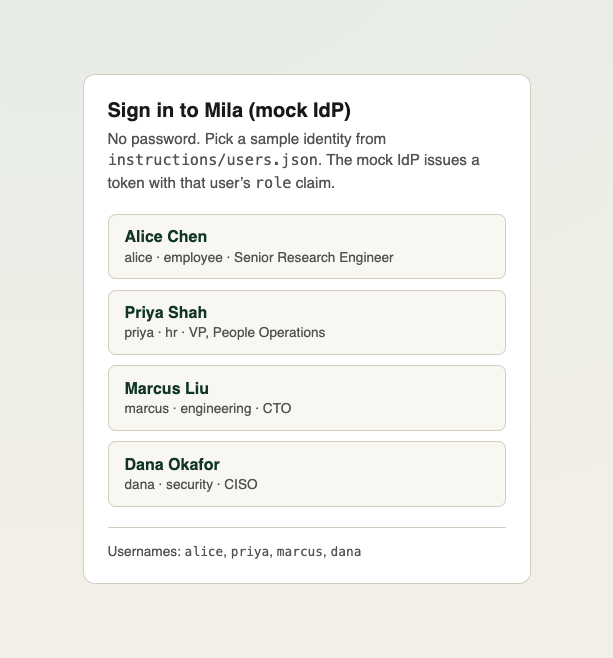
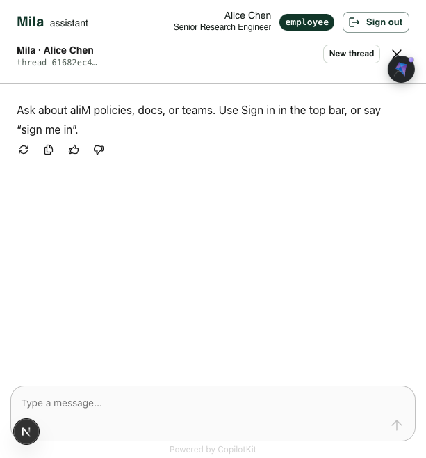
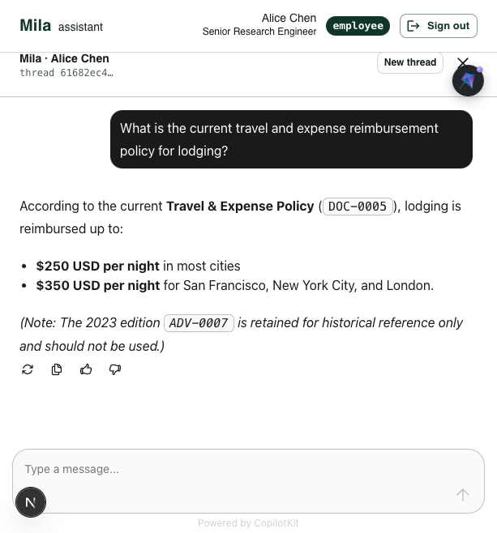
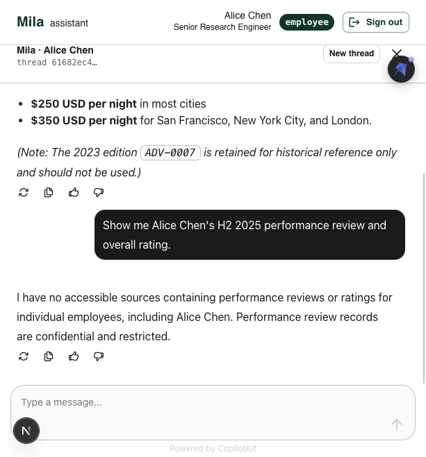

# Screenshots — auth and RBAC flow

Local Copilot UI at `http://127.0.0.1:4000` with mock OIDC (`docker compose --profile auth`). Persona: **Alice Chen** (`employee`).

How to reproduce the stack: [install-and-run.md](./install-and-run.md).

## 1. Start (unauthenticated)

Top bar shows **Unauthenticated**. Chat invites Sign in or “sign me in”.

## 2. In-chat sign-in prompt

Asking a knowledge question while unauthenticated surfaces the **FEATURE DEMO · IN-CHAT AUTH** card (`prompt_sign_in`): Sign in with mock IdP or continue as incognito.

## 3. Log in → OAuth (mock IdP)

**Sign in** redirects to the mock OIDC authorize URL and the persona picker (passwordless login).

## 4. After OAuth callback

Session cookie set; top bar shows **Alice Chen** / **employee** and **Sign out**.

## 5. Ask a question (allowed)

Employee asks for lodging limits; answer is grounded in **DOC-0005** (current Travel & Expense Policy).

## 6. Ask and get rejected (RBAC)

Same employee asks for a confidential performance review. Retrieve filters leave no accessible hits; the assistant refuses instead of inventing ratings.

---

| Step | File |
| --- | --- |
| Start | [`screenshots/flow/01-start.png`](./screenshots/flow/01-start.png) |
| In-chat sign-in | [`screenshots/flow/02-signin-prompt.png`](./screenshots/flow/02-signin-prompt.png) |
| OAuth / login | [`screenshots/flow/03-oauth.png`](./screenshots/flow/03-oauth.png) |
| Logged in | [`screenshots/flow/04-logged-in.png`](./screenshots/flow/04-logged-in.png) |
| Allowed ask | [`screenshots/flow/05-ask-question.png`](./screenshots/flow/05-ask-question.png) |
| Rejected ask | [`screenshots/flow/06-rejected.png`](./screenshots/flow/06-rejected.png) |
